# CargoFlow API — Release Safe

[](https://github.com/PumixA/release-safe/actions/workflows/ci-cd.yml)

API de devis de livraison de CargoFlow et sa chaîne de livraison : tests, image Docker versionnée,
déploiement **blue/green** derrière **Nginx** en staging et en production, vérification avant
bascule et **rollback** automatisé.

Projet DevOps réalisé par **Melvin Delorme** et **Dayana Keo**.

---

## Sommaire

1. [Architecture](#architecture)
2. [Contenu du dépôt](#contenu-du-dépôt)
3. [Lancer l'API en local](#lancer-lapi-en-local)
4. [Pipeline CI/CD](#pipeline-cicd)
5. [Livrer une version](#livrer-une-version)
6. [Rollback](#rollback)
7. [Résultats : pipelines, logs et tests](#résultats--pipelines-logs-et-tests)
8. [Exploitation](#exploitation)
9. [Contraintes du projet](#contraintes-du-projet)
10. [Choix techniques](#choix-techniques)

---

## Architecture

```
                         ┌──────────────────────── hôte de déploiement ────────────────────────┐
                         │                                                                     │
 clients ── :8080 ──────►│  Nginx (proxy)  ── route "active" ──►  green : cargoflow-api:1.2.0  │
                         │       │                                                             │
 équipe ── 127.0.0.1:18080 ──►  └─ route "preview" ─────────►  blue  : cargoflow-api:1.0.0  │
 (préversion, locale)    │                                                                     │
                         └─────────────────────────────────────────────────────────────────────┘
```

- Chaque environnement (`staging`, `production`) est un projet Docker Compose distinct
  (`deploy/compose.yaml`) avec trois services : `proxy`, `blue`, `green`.
- **Un seul point d'entrée public** par environnement : `http://localhost:8080` en production,
  `http://localhost:8081` en staging.
- Une **préversion**, accessible uniquement depuis l'hôte (`127.0.0.1:18080` / `18081`), sert à
  tester la nouvelle couleur avant de lui envoyer le trafic.
- La couleur servie est décrite dans un petit fichier généré par les scripts
  (`set $active_color blue;`). Une bascule = réécriture du fichier, `nginx -t` puis
  `nginx -s reload`. Le reload est **gracieux** : les requêtes en cours se terminent sur
  l'ancienne couleur, les nouvelles partent sur la nouvelle. Aucune coupure.
- Après une bascule, l'ancienne couleur **reste démarrée** : c'est la version de secours,
  vers laquelle on peut revenir en une seconde.

| Environnement | Point d'entrée public | Préversion (hôte uniquement) | Déploiement |
|---|---|---|---|
| staging | `http://localhost:8081` | `http://127.0.0.1:18081` | automatique (main et tags) |
| production | `http://localhost:8080` | `http://127.0.0.1:18080` | manuel, depuis un tag `vX.Y.Z` |

## Contenu du dépôt

```
src/, test/                 API (code métier fourni) et tests
  test/api.test.js          tests fournis avec l'API
  test/contract.test.js     tests de contrat de l'équipe (barème, erreurs HTTP)
Dockerfile                  image de production (non-root, healthcheck /readyz, version intégrée)
compose.yaml                lancement local de l'API seule (port 3000)
.github/workflows/ci-cd.yml pipeline CI/CD (GitHub Actions)
.gitlab-ci.yml              même pipeline pour GitLab CI
deploy/
  compose.yaml              environnement blue/green (proxy + blue + green)
  nginx/                    configuration du reverse proxy
  env/staging.env           paramètres (non secrets) de staging
  env/production.env        paramètres (non secrets) de production
scripts/
  smoke-test.sh             vérification fonctionnelle d'une instance
  deploy.sh                 déploiement blue/green avec vérification et rollback automatique
  rollback.sh               retour arrière
  status.sh                 état d'un environnement
  build.sh                  build local reproductible depuis une référence Git
  traffic.sh                trafic client pendant un déploiement (preuve d'absence de coupure)
docs/
  CHOIX_TECHNIQUES.md       justification des choix
  RUNBOOK_INCIDENT.md       procédure face à une version défectueuse
  VALIDATION.md             essais réalisés et résultats
  incidents/                comptes rendus d'incidents
  notes-de-version/         notes de version fournies (1.1.0, 1.2.0)
```

## Lancer l'API en local

Avec Node.js 22 :

```bash
npm test        # tests fournis + tests de contrat
npm start       # API sur http://localhost:3000
```

Avec Docker (API seule, port 3000) :

```bash
docker compose up --build -d
curl -i http://localhost:3000/readyz
curl -i "http://localhost:3000/api/quote?distanceKm=20&weightKg=3"
docker compose down
```

Barème de référence : 5 € fixes + 0,40 €/km + 0,20 €/kg. Pour 3 kg : 13,60 € sur 20 km,
45,60 € sur 100 km, 53,60 € sur 120 km.

### Particularités de la 1.2.0

D'après ses [notes de version](docs/notes-de-version/1.2.0.md) :

| Comportement | Réglage de l'infrastructure |
|---|---|
| ~20 s d'initialisation, `/readyz` à 503 pendant ce temps | healthcheck sur `/readyz`, `start_period: 40s` ; la bascule attend `/readyz = 200` |
| devis > 100 km : ~12 s | smoke test : 20 s max pour un devis long ; Nginx `proxy_read_timeout 30s` |
| arrêt gracieux jusqu'à 30 s | `stop_grace_period: 35s` (10 s par défaut chez Docker) |

## Pipeline CI/CD

Fichier : `.github/workflows/ci-cd.yml` (GitHub Actions). Le fichier `.gitlab-ci.yml` décrit le
même pipeline pour GitLab CI : les scripts sont identiques, seule l'orchestration change.

| Étape | Jobs | Déclenchement |
|---|---|---|
| test | `unit_tests`, `shellcheck`, `compose_config`, `secret_detection` (gitleaks, tout l'historique), `version_check` (tags) | chaque push et pull request |
| build | `build_image` : image taguée `<sha>` (+ `<version>` sur un tag), publiée sur `ghcr.io` | `main` et tags |
| verify | `image_smoke_test` : l'image publiée est démarrée et passe `smoke-test.sh` | `main` et tags |
| staging | `deploy_staging` (automatique) | `main` et tags |
| production | `deploy_production` : **approbation manuelle obligatoire** (environnement protégé) | tags `vX.Y.Z` |
| manuel | `manual_operation` : rollback ou redéploiement d'un tag (*Run workflow*) | à la demande |

Le code est testé une fois, l'image est construite une fois, et **cette même image** passe en
staging puis en production : on livre exactement ce qui a été vérifié.

### Mise en place du runner de déploiement

Les jobs de déploiement s'exécutent sur la machine de déploiement, via un runner GitHub
auto-hébergé portant le label `cargoflow-deploy` (Docker, Docker Compose, bash, curl et flock
installés) :

```bash
# Settings > Actions > Runners > New self-hosted runner : suivre les commandes affichées, puis
./config.sh --url https://github.com/<owner>/release-safe --token <jeton affiché> \
            --labels cargoflow-deploy --unattended
sudo ./svc.sh install && sudo ./svc.sh start              # ou service systemd utilisateur
sudo install -d -o "$USER" /var/lib/cargoflow            # état des déploiements

# Active les jobs de déploiement dans le pipeline
gh variable set DEPLOY_RUNNER_READY --body true
# Optionnel : autre emplacement pour l'état des déploiements (défaut /var/lib/cargoflow)
gh variable set CARGOFLOW_STATE_ROOT --body "$HOME/.local/share/cargoflow"
```

Le fichier `.env` du runner peut définir `DOCKER_CONFIG` vers un dossier dédié : la connexion
au registry faite par le pipeline n'interfère alors pas avec celle de l'utilisateur de la machine.

Tant que `DEPLOY_RUNNER_READY` n'est pas à `true`, le pipeline s'arrête après `verify` (les
déploiements sont ignorés, pas en échec).

Aucun secret n'est à créer : la publication et la récupération des images utilisent le
`GITHUB_TOKEN` fourni par GitHub à chaque exécution.

## Livrer une version

### Processus normal (par la CI)

1. Intégrer la nouvelle version sur une branche (`release/x.y.z`) et ouvrir une pull request.
   Les tests, shellcheck et la détection de secrets tournent.
2. Fusionner dans `main` : l'image `<sha>` est construite, vérifiée puis déployée
   **automatiquement en staging**.
3. Taguer la version (`git tag -a v1.2.0 -m "..." && git push origin v1.2.0`) : la version doit
   correspondre à `package.json`. L'image `1.2.0` est publiée, déployée en staging, puis
   **`deploy_production` attend l'approbation** d'un relecteur (*Review deployments*).

### Ce que fait `scripts/deploy.sh <env> <tag>`

```
 1. récupère l'image (jamais de build sur le serveur)
 2. démarre la version sur la couleur INACTIVE         ── le service continue sur l'autre couleur
 3. attend /readyz = 200 (healthcheck Docker)          ── échec : release rejetée, trafic inchangé
 4. pointe la préversion sur cette couleur et lance le smoke test
      santé, disponibilité, version exposée, barème 20/100/120 km, 400, 404, temps de réponse
                                                       ── échec : release rejetée, trafic inchangé
 5. bascule Nginx (reload gracieux)
 6. smoke test sur l'URL publique + observation du trafic
                                                       ── échec : retour AUTOMATIQUE à l'ancienne couleur
 7. l'ancienne couleur reste démarrée en secours
```

Chaque opération est tracée dans `.state/<env>/history.log` (date, action, version, couleur,
résultat, auteur, commit). Un verrou empêche deux déploiements simultanés sur un même
environnement.

### Déployer à la main (démonstration locale)

Les scripts sont ceux qu'exécute la CI. Hors CI, on construit l'image depuis Git :

```bash
scripts/build.sh v1.0.0                 # tests + image cargoflow-api:1.0.0 depuis le tag
scripts/deploy.sh production 1.0.0      # premier déploiement -> blue
curl -i http://localhost:8080/api/version

scripts/build.sh v1.2.0
scripts/deploy.sh production 1.2.0      # -> green, blue reste en secours
scripts/status.sh production
```

## Rollback

| Situation | Action | Durée |
|---|---|---|
| Échec avant bascule (pas prête, smoke test KO) | Automatique : la release est rejetée, le trafic n'a jamais quitté l'ancienne version | — |
| Échec juste après bascule | Automatique : `deploy.sh` rebascule sur l'ancienne couleur | ~1 s |
| Problème détecté plus tard | `scripts/rollback.sh <env>` ou *Run workflow* → `rollback` | ~1 s |
| Revenir à une version précise | `scripts/rollback.sh <env> <version>` : redéploiement complet depuis l'image | ~30 s |

```bash
scripts/rollback.sh production          # retour instantané sur la couleur de secours
scripts/rollback.sh production 1.0.0    # redéploie 1.0.0 depuis son image (mêmes contrôles)
```

Le rollback instantané revérifie la couleur de secours (smoke test sur la préversion) avant de
lui rendre le trafic. Si elle n'est plus disponible, le script redéploie la version précédente
depuis son image : un rollback est un déploiement comme un autre, donc reproductible.

## Historique des livraisons

| Version | Statut | Détail |
|---|---|---|
| 1.0.0 | livrée | version de référence (`v1.0.0`) |
| 1.1.0 | **refusée** | barème faux au-delà de 100 km — [compte rendu](docs/incidents/2026-11-05-release-1.1.0.md) |
| 1.2.0 | livrée | après adaptation de l'infrastructure (`v1.2.0`) |

Essais de déploiement, de rollback et de pannes : [docs/VALIDATION.md](docs/VALIDATION.md).
Procédure pour la version défectueuse de vendredi : [docs/RUNBOOK_INCIDENT.md](docs/RUNBOOK_INCIDENT.md).

## Résultats : pipelines, logs et tests

### Pipelines GitHub Actions

Toutes les exécutions du pipeline : les livraisons `v1.0.0` et `v1.2.0`, les rollbacks manuels
(*Manually run*) et le rejet de la 1.1.0.

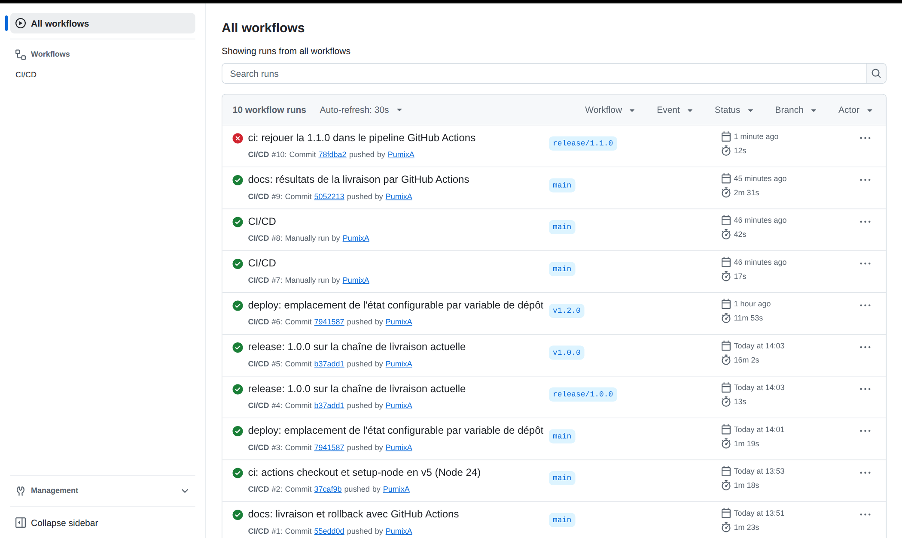

**Livraison de la 1.2.0** (tag `v1.2.0`) : tests, shellcheck, validation Compose, gitleaks et
cohérence de version en parallèle, puis build, smoke test de l'image, staging et production
(après approbation).

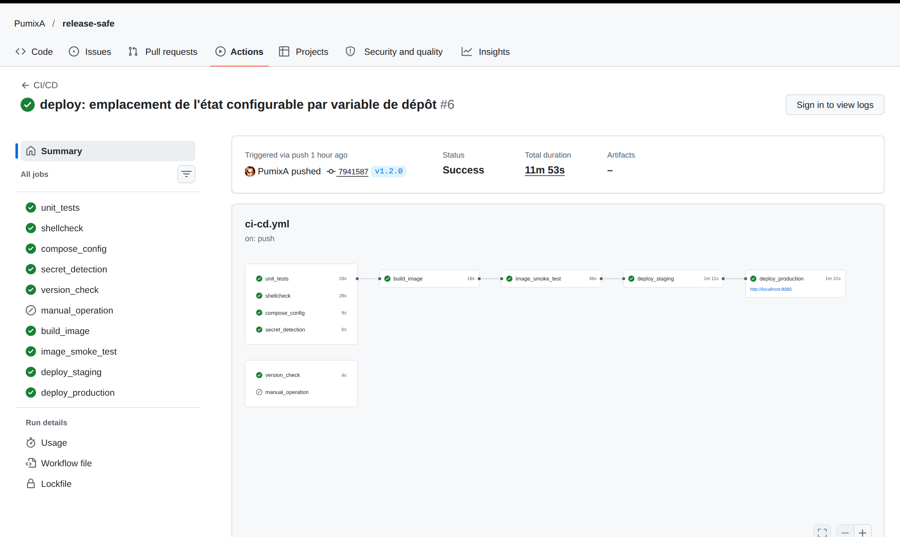

**Rejet de la 1.1.0** : le job `unit_tests` échoue, rien n'est construit ni déployé.

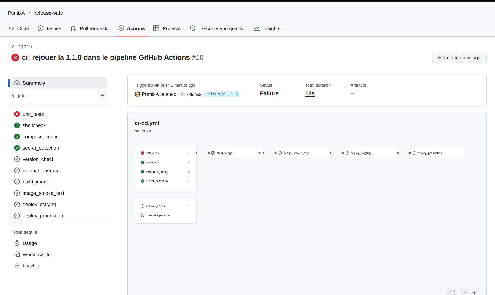

### Logs

Log du job `unit_tests` sur la 1.1.0 : nos tests de contrat révèlent le barème faux au-delà de
100 km (120 km : 10,40 € au lieu de 53,60 €).

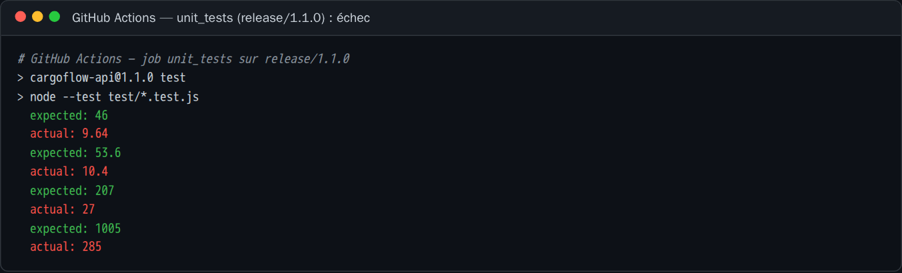

Log du job `deploy_production` (v1.2.0) : démarrage sur la couleur inactive, attente de
`/readyz` (21 s), smoke test via la préversion (devis long de 12 s compris), bascule, smoke test
public et observation.

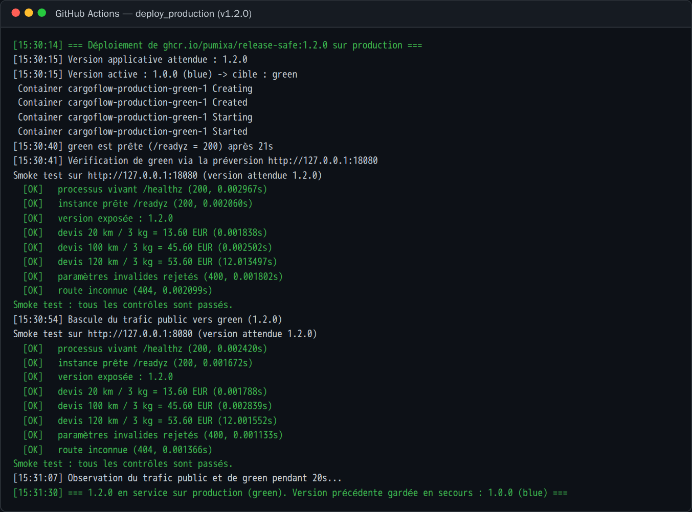

Deuxième barrière : même en forçant une image 1.1.0 jusqu'au déploiement, le smoke test la
rejette avant la bascule ; la production reste en 1.0.0.

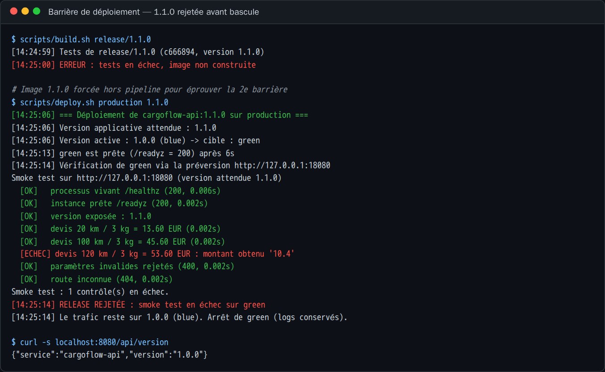

Tests de panne : une version qui plante au démarrage est rejetée en 1 s ; une version qui plante
après la bascule déclenche un rollback automatique.

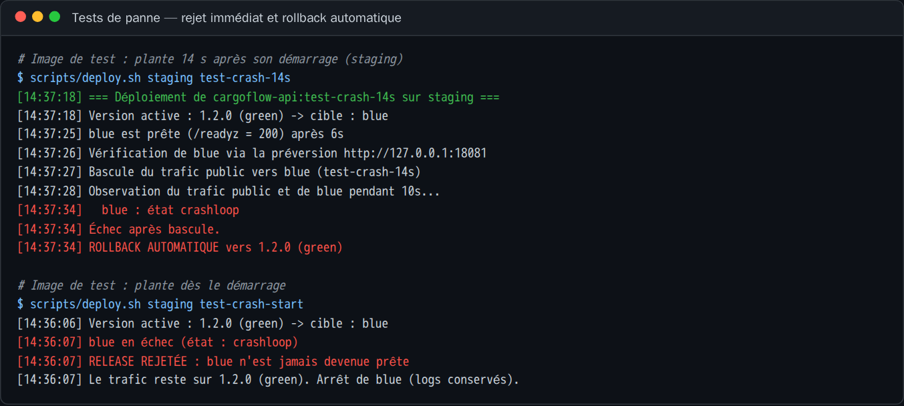

### Résultats de tests

`npm test` sur `main` (1.2.0) : 26/26 (tests fournis + tests de contrat de l'équipe).

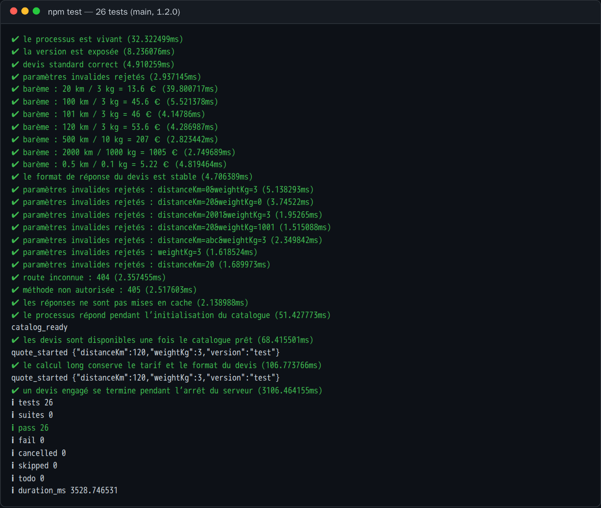

`npm test` sur la 1.1.0 : 4 échecs, tous sur le barème au-delà de 100 km.

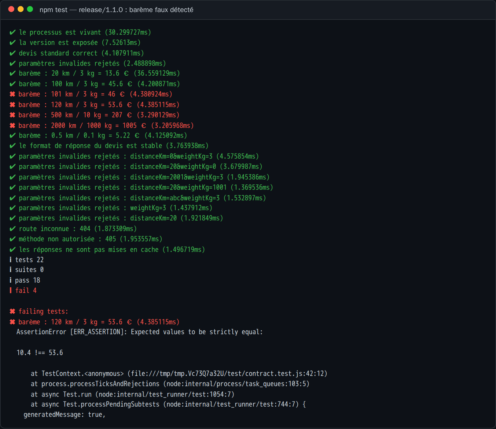

Trafic client pendant la livraison de la 1.2.0 en production par la CI : **0 erreur sur 686
requêtes**, et preuve de l'arrêt gracieux (une requête de 12 s survit à l'arrêt du conteneur
avec `stop_grace_period: 35s`, pas avec 5 s).

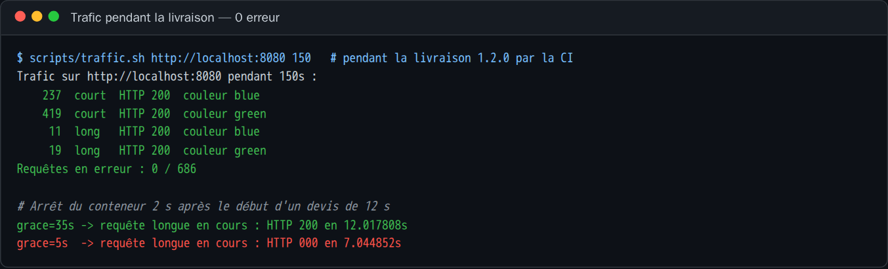

État de la production après livraison : 1.2.0 active sur green, 1.0.0 en secours sur blue.

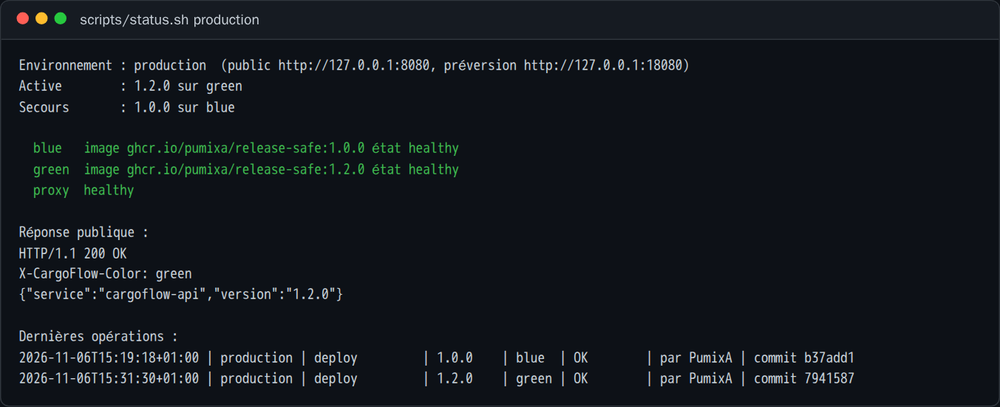

Détail de tous les essais : [docs/VALIDATION.md](docs/VALIDATION.md).

## Exploitation

```bash
scripts/status.sh production            # couleurs, versions, santé, dernières opérations
scripts/smoke-test.sh http://localhost:8080
docker compose -p cargoflow-production -f deploy/compose.yaml logs -f proxy   # couleur servie par requête
curl -si http://localhost:8080/api/version | grep -i x-cargoflow-color
scripts/traffic.sh http://localhost:8080 60                                  # trafic de test, compte les erreurs
```

## Contraintes du projet

- **Aucun secret dans Git** : aucun identifiant dans le dépôt, accès registry par le
  `GITHUB_TOKEN` éphémère, `.env*` ignorés, job `secret_detection` (gitleaks) sur tout l'historique.
- **Aucune modification manuelle de la production** : la production n'est modifiée que par
  `deploy.sh` / `rollback.sh`, lancés par le pipeline (tag Git → image → approbation → déploiement).
  L'état est tenu par les scripts, pas édité à la main.
- **Reproductibilité** : image Node figée, image construite une seule fois depuis un commit,
  identifiée par son sha et sa version, scripts idempotents, rollback = redéploiement d'une
  image existante.
- **Code métier non modifié** : les incidents sont détectés et traités par la chaîne de
  livraison (tests de contrat, smoke tests, healthchecks), jamais en changeant `src/`.

## Choix techniques

Voir [docs/CHOIX_TECHNIQUES.md](docs/CHOIX_TECHNIQUES.md).
